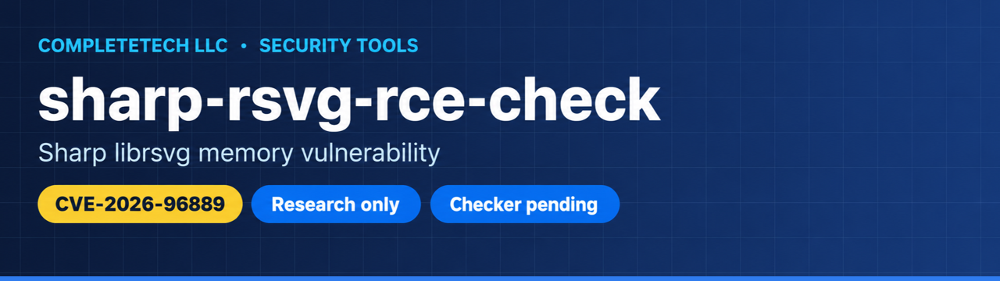
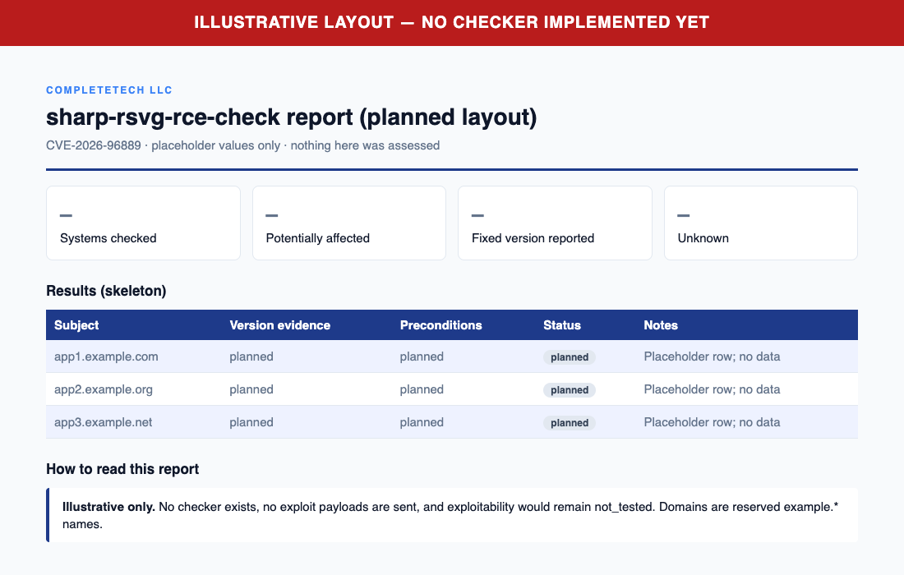

  

  
  
  

  <b>Planned checker for the Sharp librsvg memory vulnerability</b> 
  CVE-2026-96889 · GHSA-wq5f-xc86-pv6w · research only, implementation pending

---

> **Repository initialized; checker implementation pending.**
> This project currently contains research and an implementation checklist.
> It does not assess systems or provide an executable detection rule.

`sharp-rsvg-rce-check` is the dedicated repository for **CVE-2026-96889**, a memory vulnerability in the librsvg SVG decoder used by [Sharp](https://github.com/lovell/sharp). The intended checker will follow the evidence and reporting conventions of [node2shell-check](https://github.com/CompleteTech-LLC/node2shell-check) and [php2shell-check](https://github.com/CompleteTech-LLC/php2shell-check). None of it is implemented yet.

## One exploit, one repository

| Field | Scope |
| --- | --- |
| Exploit identifier | `CVE-2026-96889` |
| Aliases for this same exploit | `GHSA-wq5f-xc86-pv6w` |
| Research verification date | 2026-10-23 |
| Implementation state | `planned` |
| Detection rule | **Disabled — research only** |

This repository is dedicated to **CVE-2026-96889**. Aliases and multiple affected
products identify this same exploit; they do not create additional scanner scopes.
Future fixes for different vulnerabilities belong in independent repositories.

## Status and what's planned

There are currently **no checker commands, install steps, downloadable binaries, test results, or CI**. Work is tracked in the [implementation checklist](docs/IMPLEMENTATION.md).

The intended checker is planned to:

- Prefer offline version, inventory, or configuration evidence appropriate to this exploit.
- Keep version state, documented preconditions, evidence provenance, and uncertainty separate.
- Preserve `exploitability: not_tested`; never run exploit payloads or confirm compromise.
- Keep missing, malformed, conflicting, vendor-qualified, prerelease, and uncovered versions `unknown`.
- Produce human-readable findings and machine-readable JSON/CSV; document each output before release.
- Add bounded, explicitly selected passive network behavior only if it provides useful evidence.

## Planned report layout

The image below is an **illustrative mock-up of a possible layout**. It is not produced by any tool, contains only placeholder rows built from reserved `example.*` domains, and shows no results.

  <picture>
    <source media="(prefers-color-scheme: dark)" srcset="docs/images/report-dark.png">
    
  </picture>

Illustrative only. No checker exists yet.

## Planned status vocabulary

These statuses come from this repository's [AGENTS.md](AGENTS.md) and [implementation checklist](docs/IMPLEMENTATION.md). They are **planned** and not emitted by anything today.

| Status (planned) | Intended meaning |
| --- | --- |
| `potentially_affected` | Evidence matches this advisory's documented range or condition. Not confirmed exploitability. |
| `fixed_version_reported` | A supported comparison meets the fix. Not a verified clean bill of health or a safety guarantee. |
| `unknown` | Missing, malformed, conflicting, prerelease, vendor-built, possible-backport, or uncovered evidence. |

| Package | Affected (research) | Fixed in (reported) |
| --- | --- | --- |
| `sharp` | `<0.35.5` | `0.35.5` |

Upstream fix recorded in `advisory.json`: librsvg 2.63.2. These values are research-only and unimplemented; recheck the primary advisories before enabling any detection logic.

> [!IMPORTANT]
> **Potential exposure would not be confirmed exploitability.** A version alone cannot show that untrusted SVG reaches the decoder, the libc or PIE hardening, or a global librsvg override. Unknown libc or PIE status stays `unknown`, and `exploitability` remains `not_tested`.

## Advisory snapshot

The following is source-backed research for implementation planning. It is not a
test result, a live rule feed, or an attestation that a deployed system is patched.

**Affected versions or conditions:** `<0.35.5`

**Reported fixes or remediation:** `0.35.5`

**Deployment preconditions to establish**

- glibc Linux for documented RCE conditions
- SVG decoding
- runtime hardening including Node PIE status
- untrusted SVG reaches decoder

**Evidence notes and limitations**

- Global librsvg overrides need independent version evidence. Blocking VipsForeignLoadSvg mitigates SVG decoding; PIE mitigates RCE but does not establish library patch state. Unknown libc/PIE stays unknown.

## How it will work

Planned, not implemented: the checker would collect version and build evidence plus the preconditions above without executing application code or exploit payloads, then report each finding with its sources and uncertainty. See [docs/IMPLEMENTATION.md](docs/IMPLEMENTATION.md) for the full gated plan.

## Documentation

- [Implementation checklist](docs/IMPLEMENTATION.md) · [advisory.json](advisory.json)
- [AGENTS.md](AGENTS.md) · [Contributing](CONTRIBUTING.md) · [Security policy](SECURITY.md)

Primary sources (the research date records the supplied verification snapshot; retain contradictory evidence):

1. [github.com/lovell/sharp advisory GHSA-wq5f-xc86-pv6w](https://github.com/lovell/sharp/security/advisories/GHSA-wq5f-xc86-pv6w)
2. [github.com/advisories/GHSA-wq5f-xc86-pv6w](https://github.com/advisories/GHSA-wq5f-xc86-pv6w)

## License

[AGPL-3.0](LICENSE), or a separate commercial agreement with CompleteTech LLC.
See [LICENSING.md](LICENSING.md) and the
[contribution terms](CONTRIBUTING.md#licensing-of-contributions).
Names and branding are governed by [BRAND_ASSETS.md](BRAND_ASSETS.md).

Copyright © 2026 CompleteTech LLC.

  Built by <a href="https://complete.tech">CompleteTech LLC</a> · Innovation at Every Integration

